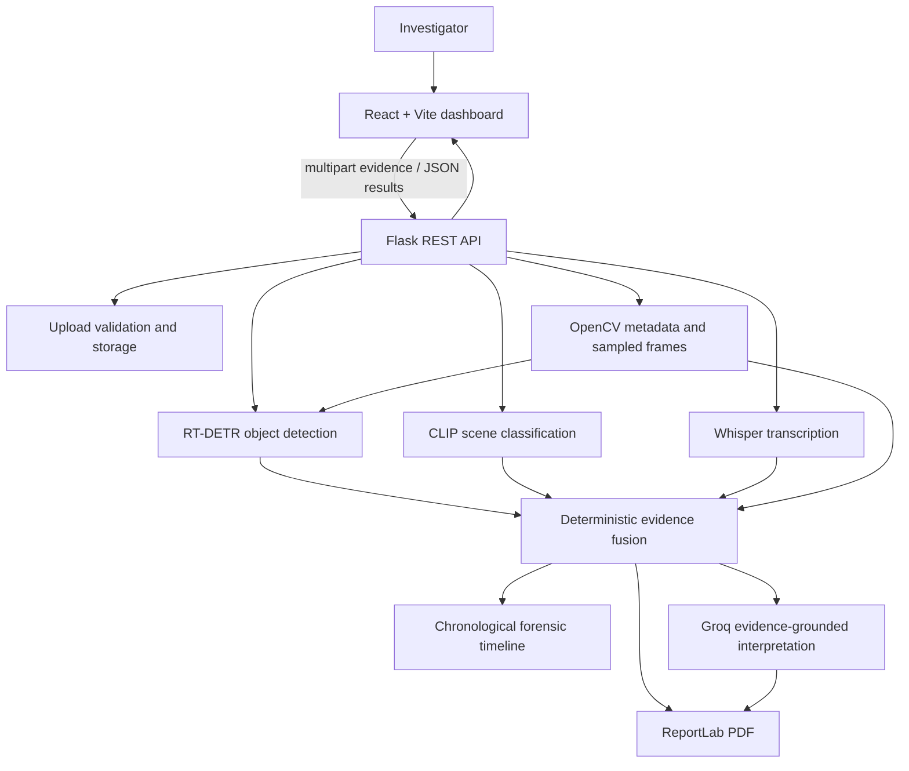

# CrimeVision AI Architecture

## High-level architecture

CrimeVision AI keeps analysis and evidence processing in the Flask/Python backend. The React application is a presentation and workflow client; it does not load models, call Groq directly, or decide what evidence means.

## Frontend/backend flow

1. The dashboard checks `GET /api/health` and collects an evidence file.
2. It uploads the selected file with `POST /api/upload` and retains the returned evidence metadata for display.
3. It invokes the matching analysis route. Images call both RT-DETR and CLIP; audio calls Whisper; video calls OpenCV frame sampling and reuses RT-DETR where available. PDF files can be uploaded, but current analysis routes do not inspect PDF contents.
4. The dashboard submits only the module response(s) to `POST /api/analyze/fusion`.
5. The fusion service returns normalized records and a chronological timeline. These deterministic records remain the displayed source of truth.
6. The optional reasoning request sends the fusion result to `POST /api/analyze/reason`. Groq returns a separate interpretation object; it cannot alter the fusion result.
7. `POST /api/report/generate` receives the fusion and reasoning results. The report is written to the configured report directory and downloaded through `GET /api/report/<report_id>`.

In development, Vite proxies `/api` calls to Flask at `http://127.0.0.1:5000`. A deployed frontend should use a same-origin reverse proxy or an explicitly configured public API base URL. The API base is public configuration; secrets must not be added to `VITE_*` variables.

## Evidence processing pipeline

### Upload and storage

`api/upload_routes.py` validates the multipart `file`, accepted extension, empty-file status, and maximum size using `utils/file_utils.py`. The stored name is generated by the backend. Uploaded evidence is saved under `UPLOAD_FOLDER`, defaulting to `data/uploads/`. Analysis routes accept their own multipart upload, save a temporary working copy in the configured upload folder, and remove that copy after inference. The initial evidence upload remains available for review.

### Modality services

- `services/object_detection_service.py` lazily loads pretrained RT-DETR, returning labels, confidence values, and image-coordinate bounding boxes.
- `services/scene_analysis_service.py` lazily loads CLIP and returns a predicted category and ranked alternatives.
- `services/audio_analysis_service.py` lazily loads Whisper and returns transcription text and language when available.
- `services/video_analysis_service.py` uses OpenCV to read video metadata and sample frames at `VIDEO_FRAME_INTERVAL_SECONDS`. Sampled-frame object detection calls the shared RT-DETR service. Temporary frame files are removed when processing ends.

Model confidence is probabilistic. Model labels and transcriptions describe automated output, not independently verified facts.

## Deterministic fusion and timeline

`services/evidence_fusion_service.py` normalizes the available modality results into evidence records with evidence identifiers, type, modality, source filename, timestamp, observation, confidence, and metadata. It orders timeline events using the supplied timestamp values and reports summary counts. Optional modalities can be absent. Fusion is deterministic and does not use an LLM.

## Groq reasoning layer

`services/groq_service.py` reads `GROQ_API_KEY` and `GROQ_MODEL` from the server environment and creates a client only when reasoning is requested. It sends selected deterministic evidence fields and validates the returned JSON shape. Provider output is presented separately from observations; uncertainty and conflicting evidence remain explicit. Groq is not called by upload, vision, audio, video, or fusion services.

## PDF report generation

`services/report_service.py` validates the fusion and reasoning structures and generates a uniquely named ReportLab PDF in `REPORT_FOLDER` (default `data/reports/`). It includes evidence summaries and tables, model-result sections, timeline data, reasoning, uncertainty, recommended checks, and the forensic disclaimer. Missing evidence observations retain the safe wording “Not provided in submitted evidence.” PDF page content is written uncompressed to preserve visible, searchable report text. Download routes accept an opaque report ID rather than a filesystem path.

## Security boundaries and operational notes

- Groq credentials stay in the backend environment. They are never sent in an API response or bundled into React.
- `.env` is excluded by `.gitignore`; `.env.example` contains placeholders and non-secret defaults only.
- Flask debug mode is disabled by default. Set `FLASK_DEBUG=true` only for local development. Do not expose Flask's development server directly to the public internet; use a production WSGI server and a reverse proxy for deployment.
- Upload names are generated server-side; API errors returned to the browser are user-facing messages, not tracebacks.
- Uploaded evidence and generated reports may contain sensitive data. Restrict filesystem and network access, establish retention/deletion procedures, and use access controls before deploying for real case material. The current application does not implement user authentication or a case database.
- Uploads and reports are stored beneath the configured directories. `PROCESSED_FOLDER` is retained as a configuration option; current video frame processing uses an automatically cleaned temporary directory.
- Pretrained model weights are loaded lazily and may be downloaded by Transformers or Whisper on first use. Keep model cache and evidence directories outside public static serving.

## Storage and environment configuration

The Flask app configuration reads `SECRET_KEY`, `FLASK_DEBUG`, `RTDETR_CONFIDENCE_THRESHOLD`, and the storage paths. The Groq and model services read their model/provider settings from the environment. `FLASK_HOST` and `FLASK_PORT` configure the local development server. Defaults and setup instructions are listed in the root README.
